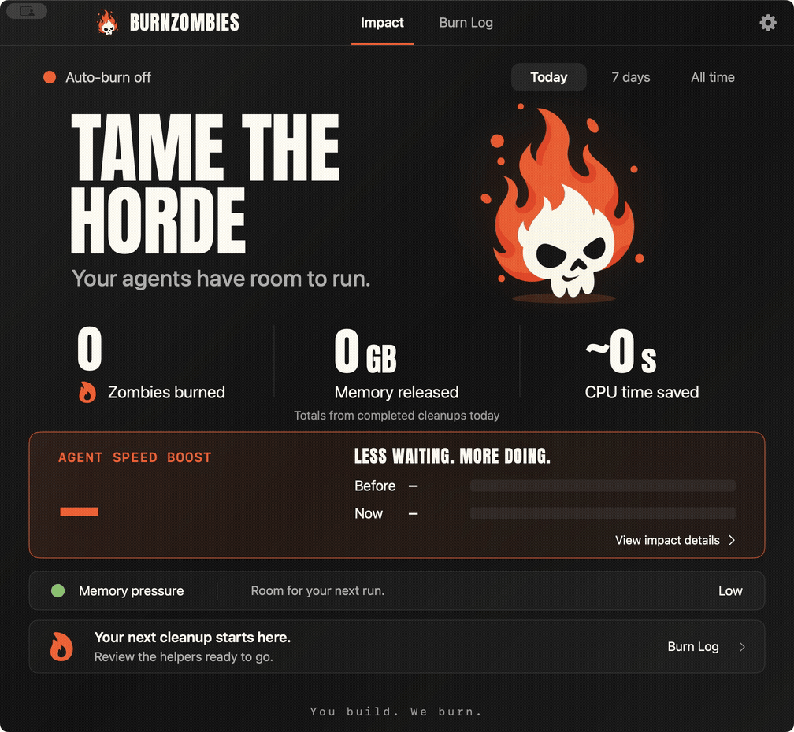

<p align="center"></p>

# BurnZombies

**Keep yesterday’s agent runs from slowing down today’s.**

Long-running agents and harnesses leave more than code behind. Finished sessions, cancelled runs and retries can leave helpers running in the background, taking up resources your next job needs.

BurnZombies lives in your Mac’s menu bar, spots the buildup, and burns eligible abandoned helpers. Get memory back. Clear the dead weight. Keep building.

[](#install)
[](docs/MCP.md)
[](LICENSE)

## Install

```sh
curl -fsSL https://raw.githubusercontent.com/swordfish444/BurnZombies/main/install.sh | bash
```

Apple Silicon or Intel, macOS 14+. Installs the app and connects Codex or Claude Code when available. No compiler or package manager needed. [Install options](docs/INSTALL.md).

Start a new agent session and ask:

> **Tame the horde with BurnZombies.**

Or ask your agent to handle setup:

> Install BurnZombies and connect its MCP server using https://github.com/swordfish444/BurnZombies/blob/main/docs/INSTALL.md

## Dead weight. Gone.



- **Find the buildup.** See abandoned helpers, growing resource use and recurring processes grouped into activities.
- **Reclaim room for the next run.** Stop eligible leftovers while active and uncertain work stays protected.
- **Let your agent handle it.** Check, preview and burn through MCP, using the same cleanup rules as the app.
- **See the payoff.** Verified burns, memory released, CPU time saved and before/after local responsiveness.

Monitoring starts immediately. Cleanup covers explicitly registered disposable helpers; [connect your helper workflow](docs/MCP.md#track-disposable-helpers) to make them eligible.

Local monitoring. No BurnZombies account, cloud service or subscription.

**Next:** deeper harness integrations, notarized Mac releases, and Windows. [Roadmap →](docs/ROADMAP.md)

[User guide](docs/USER_GUIDE.md) · [MCP](docs/MCP.md) · [How cleanup works](docs/SAFETY.md) · [Build & contribute](CONTRIBUTING.md) · [Security](SECURITY.md)

If BurnZombies clears room for your next run, **give it a star**. [Tell us what your agents leave behind](https://github.com/swordfish444/BurnZombies/issues/new?template=feedback.yml).

**You build. We burn.**
