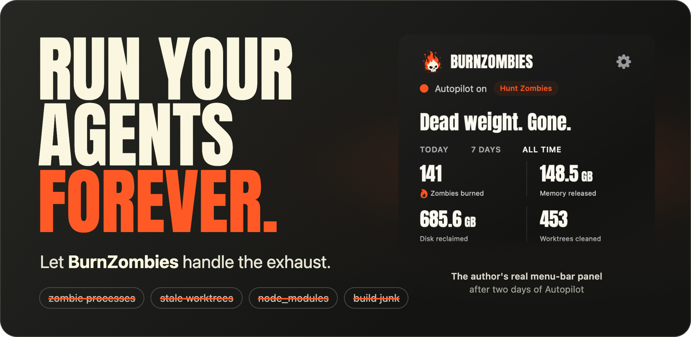
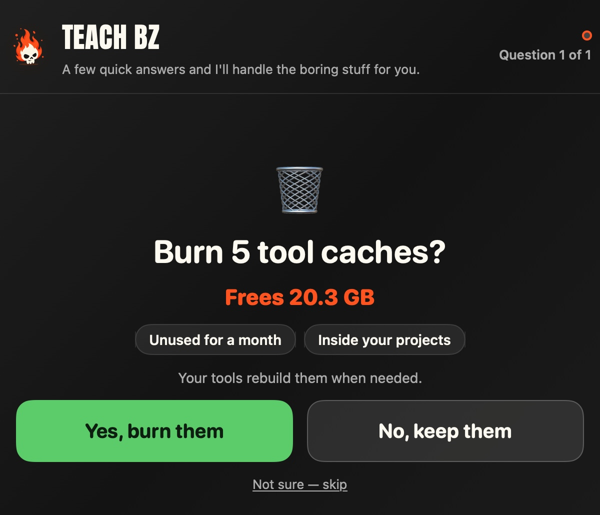

<p align="center">
  <picture>
    <source media="(max-width: 600px)" srcset="docs/media/readme-hero-phone.png">
    
  </picture>
</p>

<h3 align="center">BurnZombies (BZ) cleans up after your AI coding agents, on its own.</h3>

<p align="center">
  It stops the processes they orphan and deletes the worktrees and rebuildable junk they leave behind, saving each worktree's commits and changes first. On the author's Mac, which had about 1,000 agent worktrees, its first two days freed <b>685.6 GB</b> and cleared <b>453</b> stale worktrees, most of them under rules learned from 19 one-tap answers.
</p>

<p align="center">On your Mac, paste this into Terminal:</p>

```sh
curl -fsSL https://raw.githubusercontent.com/swordfish444/BurnZombies/main/install.sh | bash
```

<p align="center"><sub>macOS 14+ · no account, API key or sudo · free and open source (MIT) · signed, not yet notarized by Apple · <a href="install.sh">read the script first</a><br>Want to look first? Use <code>| bash -s -- --look-only</code> instead of <code>| bash</code>: BZ finds and asks but burns nothing until you choose <b>Start burning</b>.<br>If Claude Code or Codex is signed in, BZ also runs AI sweeps on your login, about $0.30–$1.20 each at API prices. To skip them, add <code>--observe-only</code> the same way.</sub></p>

## How it works

1. **Install it.** One command. A flaming skull joins your menu bar and shows what it found within a minute.
2. **Run your agents.** Claude Code, Codex, Cursor: as many sessions, worktrees, dev servers and builds as you like. Nothing about how you work changes.
3. **BZ burns the exhaust.** From the first minute, and every 15 minutes after, it stops orphaned processes and deletes stale worktrees and rebuildable junk, backing up each worktree first. When it isn't sure, it asks you once, and your answer becomes a rule.

<p align="center">
  
  <br><sub>When BZ isn't sure, it asks. One tap, and it remembers. (Example data.)</sub>
</p>

## What happens next

- **Minute one:** BZ shows what it found, burns what's clearly safe and asks about the rest. With `--look-only` it shows and asks but burns nothing until you choose **Start burning**.
- **Around minute 10:** if Claude Code or Codex is signed in, the first AI sweep judges what the rules don't cover.
- **From then on:** BZ looks every 15 minutes, quietly. AI sweeps run only when there's something new to judge, at most every 30 minutes.
- **After a restart:** BZ comes back only if **Start at login** is on in Settings, so switch it on once.

## What it burns

To BZ, burning means stopping a program or deleting a folder.

- 🧟 **Zombie processes**: Node workers, headless browsers and build watchers left running after their app or chat is gone.<br>
  **Safety net:** a polite `SIGTERM`, sent only after an exact identity check.
- 📁 **Stale worktrees** nothing is using.<br>
  **Safety net:** first, a Git ref inside the repo saves every commit, uncommitted change and untracked file, plus small ignored files. If BZ can't verify that backup, the worktree stays. Branches are kept. Restore in one click from **Findings** for 30 days; the ref stays in the repo after that.
- 🗑️ **Rebuildable junk**: `node_modules`, build output, DerivedData.<br>
  **Safety net:** your tools rebuild it when needed.

## Safe by default

- **Hands off what's in use:** never macOS, your apps, your AI tools, your main project folders, or anything a program or an open chat is using.
- **Your agents' worktrees wait for your yes,** and **No** or **Keep forever** always wins.
- **Every worktree is backed up** to a Git ref first; restore it in one click or by hand.

<details>
<summary><b>Exactly what it burns on its own</b></summary>

- **Starter rules** (switch each off in **Settings → Autopilot**): orphaned programs that have barely used the CPU for 6+ hours and have no open port, merged worktrees with no local changes untouched for a month, and junk inside worktrees untouched for two weeks.
- **The AI,** if on, may burn a low-risk item only when it rates itself at least 85% sure: an orphaned program with no open port, a known junk folder, or a worktree nothing uses. Every burn it asks for passes BZ's own checks.
- **Never on its own:** worktrees made by Claude Code, Codex or the Conductor app. Other worktrees, such as ones Cursor or your scripts make, follow the two rules above.
- **Your yes answers:** a question says what it covers, like "Burn 5 tool caches?", and **Yes** also covers new matches later. Forget any rule in **Settings → Autopilot → What BZ has learned**.
- **Limits:** at most 20 worktrees, 20 junk folders and 50 programs per look. BZ knows an idle Claude Code or Codex chat is still open from the session records those tools keep.

The [tests](Proof) check these rules on every code change. [How cleanup stays safe →](docs/SAFETY.md)

</details>

## FAQ

<details>
<summary><b>What does the AI cost, and can I turn it off?</b></summary>

Without Claude Code or Codex signed in there's no AI at all; with one, AI sweeps are on by default and run on your login: roughly $0.30–$1.20 a sweep at API prices, or plan usage on a subscription. They run only when there's something new to judge, at most every 30 minutes, so a quieter Mac runs fewer. On the author's Mac, working through about 1,000 worktrees in its first days, they came to about $13–23 a day at API prices. There's no spending cap yet; **Settings → Usage & estimated cost** shows what they used. Turn them off with `~/Applications/BurnZombies.app/Contents/MacOS/burnzombies setup --observe-only` (`--with-ai` turns them back on); the starter rules and your answers keep cleaning. [Model and cost →](docs/INSTALL.md#model-and-cost)

</details>

<details>
<summary><b>What does the AI see?</b></summary>

The plain facts BZ gathered about each item, like where it is, its size and what started it, plus any project files it reads in the folders it's judging, such as `package.json`, READMEs and configs. It's told never to read secrets such as `.env` files, keys or credentials. Its shell and web tools are switched off: it reads, then asks BZ to burn, and every burn it asks for passes BZ's own checks. All of it goes through your own Claude Code or Codex login, like any other request you make with it.

</details>

<details>
<summary><b>Can I see what it would burn before it burns anything?</b></summary>

Yes: install with `--look-only` (`curl … | bash -s -- --look-only`). BZ finds, sizes and asks exactly as usual, and **Findings** lists everything it found, why, and what burning it would do. Nothing burns on its own: not the starter rules, not your yes answers, not the AI. The menu says **Look-only · nothing burns** and how much it would burn. When you're ready, choose **Start burning** there, or switch off **Look only** in **Settings → Autopilot**, and what waited burns right away. A **Burn now** you click on one item still burns that item.

Already installed? Switch on **Look only** in **Settings → Autopilot**. `--observe-only` is not a dry run: it only turns the AI off, and the rules keep burning.

</details>

<details>
<summary><b>Can I undo a burn?</b></summary>

Worktrees, yes: **Restore** in **Findings** for 30 days. The restore point is a Git ref in the repo that holds every commit and local change, small ignored files such as `.env` included; ignored files over 5 MB and anything inside rebuildable folders aren't kept. The ref stays local unless you push `refs/burnzombies/*` yourself, for example with `git push --mirror`. It stays after 30 days, so you can also restore by hand, without the app:

```sh
git for-each-ref refs/burnzombies/retired          # list restore points
git worktree add --detach ../my-copy refs/burnzombies/retired/<id>
git -C ../my-copy reset HEAD^   # only if the top commit is a "BurnZombies safety copy"
```

Junk folders get rebuilt by your tools. Programs get a graceful stop, which can't be undone.

</details>

<details>
<summary><b>I run long background jobs on purpose. Are they safe?</b></summary>

Click **Keep forever** on one in **Findings**, and BZ and the AI leave it alone. On its own, BZ only stops a program whose app or chat is gone and that has no open port.

</details>

<details>
<summary><b>Does it need Full Disk Access?</b></summary>

No. Without it, BZ skips the places macOS protects (Desktop, Documents, Downloads, iCloud Drive and other apps' data) and tells you what it skipped. With it, the same rules cover those folders too. To grant it, click **Allow Full Disk Access** in the menu. [Access setup →](docs/INSTALL.md#optional-full-disk-access)

</details>

<details>
<summary><b>What does the install script do?</b></summary>

It downloads the release it pins, checks it against that release's SHA-256 checksums, checks the archive's paths and the app's code signature, and puts BurnZombies.app in `~/Applications`. No sudo. Releases are signed with BurnZombies' own certificate but aren't notarized by Apple yet. Prefer a fixed version? Swap `main` in the URL for a release tag, such as `v0.13.0`. [Read install.sh](install.sh) · [Installer options →](docs/INSTALL.md#installer-options)

</details>

<details>
<summary><b>What does it install, and does it phone home?</b></summary>

One app in `~/Applications`, with its `burnzombies` command inside it, and a data folder in `~/Library/Application Support/BurnZombies`. Setup writes only BZ's own settings, not your agents'. There's no login item until you switch on **Start at login**, no auto-update (run the install line again to update) and no telemetry: BZ itself makes no network requests. The only traffic is your AI sweeps through your own Claude Code or Codex login and, on request, a GitHub CLI lookup of a worktree's pull request.

</details>

<details>
<summary><b>Can Claude Code or Codex install it for me?</b></summary>

Yes. Give it this prompt:

> Install and set up BurnZombies using https://raw.githubusercontent.com/swordfish444/BurnZombies/main/llms.txt. Preserve my existing agent settings and verify setup without running cleanup.

</details>

<details>
<summary><b>How do I uninstall?</b></summary>

Stop BZ, then delete the app and its data folder. Restore points stay in your repos until you delete them. [Three steps →](docs/INSTALL.md#uninstall)

</details>

## Learn more

[User guide](docs/USER_GUIDE.md) · [How Autopilot decides](docs/AUTOPILOT.md) · [Safety](docs/SAFETY.md) · [Install options](docs/INSTALL.md) · [MCP server](docs/MCP.md) · [Feedback](https://github.com/swordfish444/BurnZombies/issues/new?template=feedback.yml)

<p align="center"><b>You build. We burn.</b></p>
