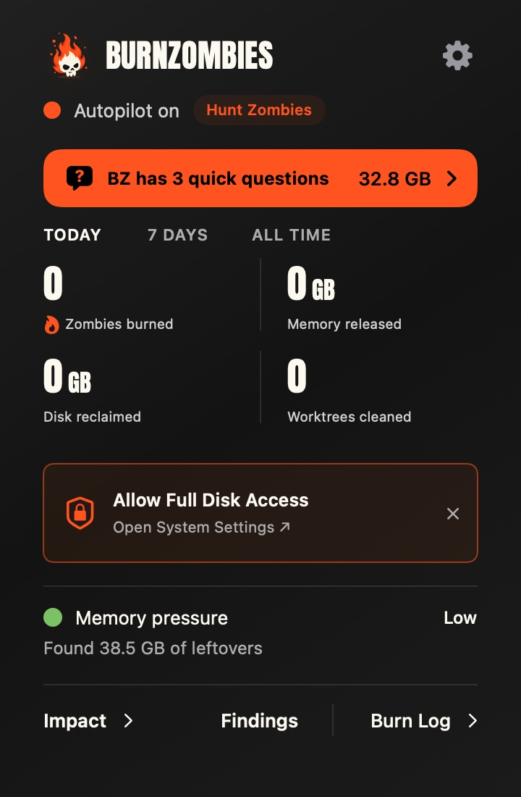

<p align="center">
  
</p>

<p align="center">
  <b>BurnZombies (BZ) cleans up after your AI coding agents, on its own.</b><br>
  It stops the processes they orphan and deletes the worktrees and rebuildable junk they leave behind, backing up every worktree first. In its first two days on the author's Mac, it freed <b>685.6 GB</b> and cleared <b>453</b> stale worktrees.
</p>

<p align="center">On your Mac, paste this into Terminal:</p>

```sh
curl -fsSL https://raw.githubusercontent.com/swordfish444/BurnZombies/main/install.sh | bash
```

<p align="center"><sub>macOS 14+ · no account, API key or sudo · free and open source (MIT) · <a href="install.sh">read the script first</a></sub></p>

## How it works

1. **Install it.** One command. A flaming skull joins your menu bar, and within a minute it shows what it found.
2. **Run your agents.** Claude Code, Codex, Cursor: as many sessions, worktrees, dev servers and builds as you like. Nothing about how you work changes.
3. **BZ burns the exhaust.** Every 15 minutes it stops orphaned processes and deletes stale worktrees and rebuildable junk, backing up each worktree first. When it isn't sure, it asks you one yes/no question and remembers your answer.

<p align="center">
  
  &nbsp;
  
</p>
<p align="center"><sub><b>Minute one:</b> what BZ found &nbsp;·&nbsp; <b>When it isn't sure:</b> one tap, and it remembers &nbsp;·&nbsp; example data</sub></p>

## What it burns

| The exhaust | The safety net |
| --- | --- |
| 🧟 **Zombie processes**: orphaned Node workers, headless browsers and build watchers still running after their app or chat is gone | A polite `SIGTERM`, sent only after an exact identity check. |
| 📁 **Stale worktrees** nothing is using | A Git ref inside the repo first saves every commit, uncommitted change and untracked file, and BZ verifies it. Restore from **Findings** for 30 days. |
| 🗑️ **Rebuildable junk**: `node_modules`, build output, DerivedData | Your tools rebuild it when needed. |

## Safe by default

- **Hands off what's yours.** BZ never touches macOS, your apps, your AI tools, your main project folders, or anything a running Claude Code or Codex chat is working in. It knows which chats are running from the session records those tools keep on your Mac.
- **On its own, only the obvious.** Starter rules burn programs whose app or chat is gone after 6+ idle hours with no open port, merged worktrees with no local changes untouched for a month, and junk inside worktrees untouched for two weeks. Switch any of them off in **Settings → Autopilot**.
- **The AI is boxed in.** With Claude Code or Codex signed in, it may burn an item on its own only when it's at least 85% sure and the item is low-risk: an orphaned program with no open port, a known junk folder, or a worktree nothing uses. Worktrees that Claude Code, Codex or Conductor made are never burned without your yes.
- **You have the last word.** **No** and **Keep forever** always win. Each **Yes** becomes a rule you can see and forget in **Settings → Autopilot → What BZ has learned**. **Findings** shows every item, why BZ thinks so, and what burning it does.
- **Checked, not promised.** At most 50 programs, 20 worktrees and 20 junk folders go per look, and locked or mid-merge worktrees are refused. The [proof suite](Proof) tests these rules on every code change. [How cleanup stays safe →](docs/SAFETY.md)

## What happens next

- **Minute one:** BZ shows what it found and asks its first questions.
- **First half hour:** it looks every minute. With Claude Code or Codex signed in, the first AI sweep starts around minute 10.
- **From then on:** it looks every 15 minutes, quietly. Open the panel any time to see what you got back.

## FAQ

<details>
<summary><b>Does it use AI? What does that cost?</b></summary>

Only if Claude Code or Codex is installed and signed in; then AI sweeps are on by default. A sweep runs your own Claude Code or Codex with your login, only when there's something new to judge: at most every 30 minutes, plus a recheck every 4 hours. On API pricing a sweep costs roughly $0.30–$1.20; on a Claude or ChatGPT subscription it uses plan usage. **Settings → Usage & estimated cost** shows what sweeps used. To keep AI off, install with `curl … | bash -s -- --observe-only`, or run `burnzombies setup --observe-only` later. [Model and cost →](docs/INSTALL.md#model-and-cost)

</details>

<details>
<summary><b>What does the AI see?</b></summary>

The plain facts BZ gathered about each item, like where it is, its size and what started it, plus any project files it reads in the folders it's judging, such as `package.json`, READMEs and configs. It's told never to read secrets such as `.env` files, keys or credentials. All of it goes through your own Claude Code or Codex login, like any other request you make with it.

</details>

<details>
<summary><b>Can I see what it would burn before it burns anything?</b></summary>

**Findings** lists everything BZ found, why, and what burning it would do. There's no look-only mode yet: the starter rules start in the first minute. Everything they burn is backed up (worktrees), rebuildable (junk) or an orphaned program that sat idle for 6 hours. `--observe-only` turns off only the AI.

</details>

<details>
<summary><b>Can I undo a burn?</b></summary>

Worktrees, yes: **Restore** in **Findings** for 30 days. The restore point is a Git ref in the repo (`refs/burnzombies/retired/…`) that holds every commit and local change. Ignored files over 5 MB and anything inside rebuildable folders aren't kept. Junk folders get rebuilt by your tools. Programs get a graceful stop, which can't be undone.

</details>

<details>
<summary><b>I run long background jobs on purpose. Are they safe?</b></summary>

On its own, BZ only stops a program whose app or chat is gone and that has no open port: the starter rule also waits for 6+ idle hours, and the AI must be at least 85% sure. For anything you want kept no matter what, click **Keep forever** on it in **Findings**; BZ and the AI then leave it alone.

</details>

<details>
<summary><b>Does it need Full Disk Access?</b></summary>

No. Without it, BZ skips the places macOS protects (Desktop, Documents, Downloads, iCloud Drive and other apps' data) and tells you what it skipped. With it, the same rules cover those folders too. To grant it, click **Allow Full Disk Access** in the menu. [Access setup →](docs/INSTALL.md#optional-full-disk-access)

</details>

<details>
<summary><b>What does the install script do?</b></summary>

It downloads the release it pins, checks it against that release's SHA-256 checksums, checks the archive's paths and the app's code signature, and puts BurnZombies.app in `~/Applications`. No sudo. Releases are signed with BurnZombies' own certificate but aren't notarized by Apple yet. [Read install.sh](install.sh) · [Installer options →](docs/INSTALL.md#installer-options)

</details>

<details>
<summary><b>Can my agent install it?</b></summary>

Yes. Give Claude Code or Codex this prompt:

> Install and set up BurnZombies using https://raw.githubusercontent.com/swordfish444/BurnZombies/main/llms.txt. Preserve my existing agent settings and verify setup without running cleanup.

</details>

<details>
<summary><b>How do I uninstall?</b></summary>

Stop BZ, then delete the app and its data folder. Restore points stay in your repos until you delete them. [Three steps →](docs/INSTALL.md#uninstall)

</details>

## Learn more

[User guide](docs/USER_GUIDE.md) · [How Autopilot decides](docs/AUTOPILOT.md) · [How cleanup stays safe](docs/SAFETY.md) · [Install options](docs/INSTALL.md) · [MCP](docs/MCP.md) · [Tell us what your agents leave behind](https://github.com/swordfish444/BurnZombies/issues/new?template=feedback.yml)

<p align="center"><b>You build. We burn.</b></p>
