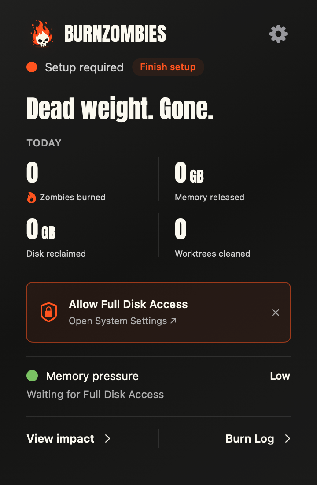
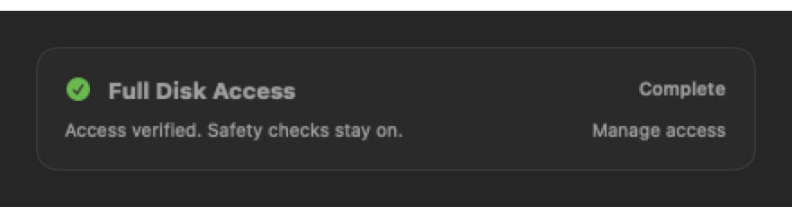
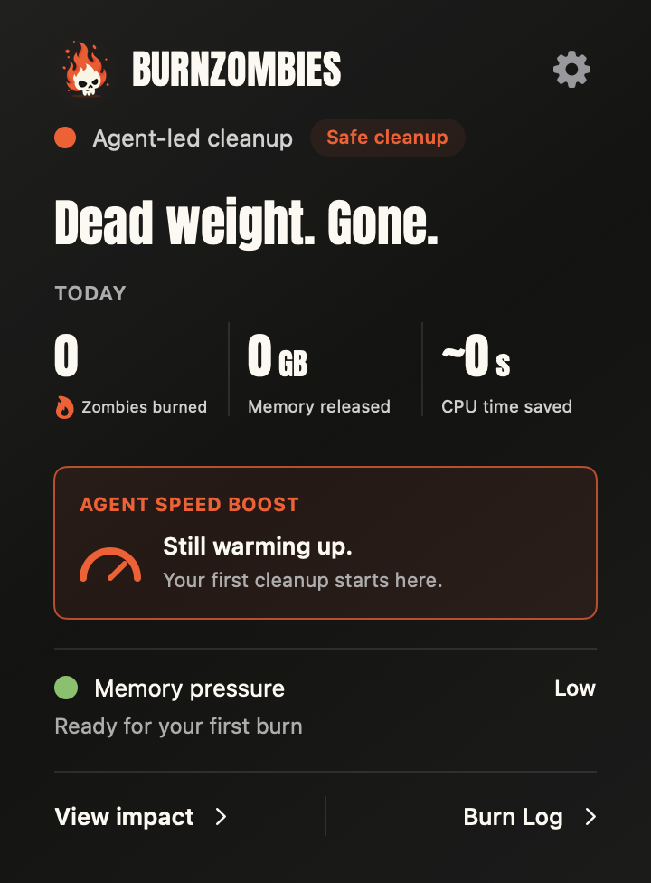
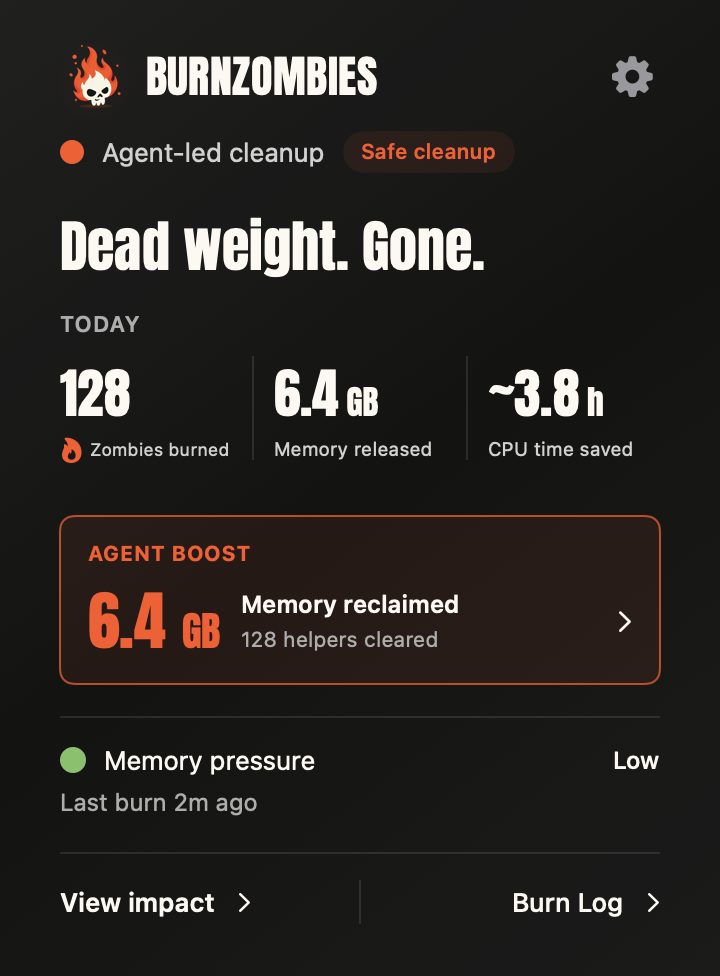
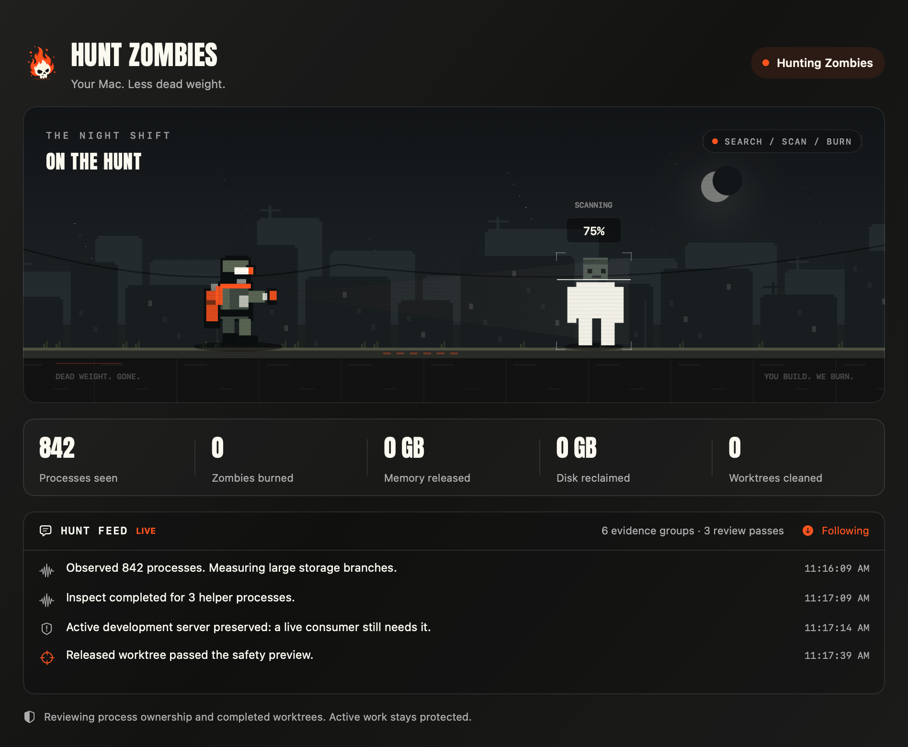
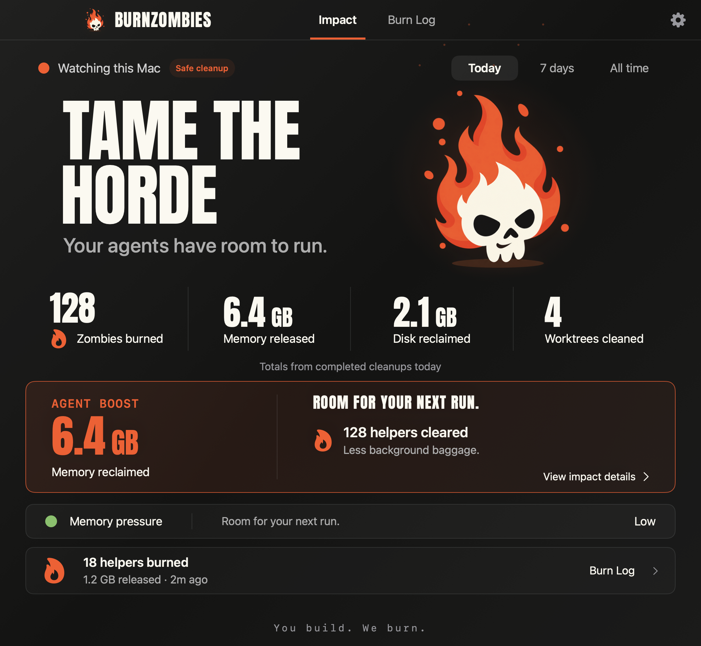

<p align="center"></p>

# BurnZombies

**Keep your agents running. Lose the leftovers — on autopilot.**

Long agent sessions leave a mess: orphaned Node workers, robot browsers, build watchers, worktrees nobody opens again and gigabytes of rebuildable junk. BurnZombies sweeps your whole Mac every 15 minutes, burns what is safe, and when it isn't sure it asks you one tiny yes/no question. Every answer becomes a rule. After about a dozen answers it runs itself.

| It burns | How |
| --- | --- |
| 🧟 **Zombies** — programs whose app or chat is gone | A graceful stop. Programs a live chat is using are never touched. |
| 📁 **Old copies** — git worktrees you stopped using | Every commit and change is saved in a restore point first. One click restores it. |
| 🗑️ **Junk folders** — `node_modules`, build output, DerivedData | Deleted; your tools rebuild them when needed. |

Your existing harness (Claude Code by default, or Codex) does the thinking in short headless sweeps; native code supplies facts, enforces the safety rails and verifies every result. [How Autopilot decides →](docs/AUTOPILOT.md)

[](#install)
[](docs/MCP.md)
[](LICENSE)

## Install

**Installing with an agent?** Give Codex or Claude Code this prompt:

> Install and set up BurnZombies using https://raw.githubusercontent.com/swordfish444/BurnZombies/main/llms.txt. Preserve my existing agent settings and verify setup without running cleanup.

The [agent setup guide](https://raw.githubusercontent.com/swordfish444/BurnZombies/main/llms.txt) covers both harnesses, permissions, updates and read-only verification.

```sh
curl -fsSL https://raw.githubusercontent.com/swordfish444/BurnZombies/main/install.sh | bash
```

Apple Silicon or Intel, macOS 14+. The installer selects an available **Codex or Claude Code**, starts the menu bar observer, and configures one background reviewer. The reviewer connects privately when needed; everyday chats get no hooks or always-loaded MCP connection. Use your existing harness login. No BurnZombies account, API key or package manager. Add `--observe-only` to leave AI reviews disabled during setup. New installations require cleanup approval or an explicit scoped rule.

**One optional macOS step:** BurnZombies works right away everywhere except the folders macOS protects (Desktop, Documents, Downloads, iCloud Drive, Mail, Messages, Photos, other apps' data and external drives). To cover those too and turn on AI hunts, click **Allow Full Disk Access** in the menu-bar banner to open the right System Settings pane, then enable **BurnZombies**. Return to the app and it checks access automatically. If macOS asks, choose **Quit & Reopen**; the access check continues automatically after relaunch. macOS requires you to grant the permission yourself; your agent handles the installation.

Dismiss the banner with **×** whenever you like; setup remains under the **Settings cog → Full Disk Access**. Once verified, the banner disappears and Settings shows a muted completed section with a green checkmark. Without access it keeps working and says what it skipped; dismissing the reminder never widens what it covers. [Access setup →](docs/INSTALL.md#optional-full-disk-access)

<details>
<summary>See the permission setup</summary>

<p align="center"></p>
<p align="center"></p>

</details>

Supported tools also supply their own live ownership evidence: idle Gradle daemons can retire through Gradle, and unused Docker build cache can be reclaimed through BuildKit. Codex and Claude Code ownership and completion evidence is collected passively from local session metadata. Your working chats do no BurnZombies bookkeeping. Native evidence is batched into deep hunts every four hours by default; incomplete or ambiguous evidence stays protected. The observer continues across projects, even with no chat open. [Setup details →](docs/INSTALL.md)

Want to choose the brain? **Settings → Review intelligence** lets you set the model and thinking level. Expand **Usage & estimated cost** for hourly or daily charts, 1, 7 or 30 days, cached/uncached input and output, and per-model cost estimates. Observation between hunts uses no model tokens. Each hunt gives your harness focused evidence and skips work already resolved.

Installing through an agent? Tell it:

> **Install BurnZombies to watch this Mac and clean up abandoned agent helpers in the background.**

## Teach BZ in a dozen taps

When Autopilot isn't sure, the menu shows **BZ has 3 quick questions**. Each one is a single card — **Burn 92 old project copies?** **Frees 14.4 GB**, with a few short facts like "Saved on GitHub" and "Unused for a week" (risky ones in amber) — and **Yes, burn them** / **No, keep them**. BZ only asks about patterns that free at least 1 GB. Yes burns the matches right away and every future match; No protects them for good. **Findings** shows everything in plain words: what it is, why BZ thinks so, and what happens if it burns it, with technical details tucked away. Settings → **What BZ has learned** lists every rule with a Forget button.

## Dead weight. Gone.

Everything that matters in one small panel: **zombies burned, memory released, disk reclaimed, worktrees cleaned and agent boost.** Every verified cleanup shows what you got back: reclaimed memory and helpers cleared, or a measured speed boost when available. **Still warming up.** only appears before your first burn.

<p align="center">
  
  
</p>

**Small by default. More when you need it.** Open Impact for Today, 7 days or All time. Burn Log keeps the cleanup receipts one click away.

### Hunt Zombies

Want to clear the buildup now? Click **Hunt Zombies** in the menu bar. It starts a deep review of process, worktree and disk evidence with your selected harness. **Hunting Zombies →** opens the live hunt: a side-scrolling patrol, suspicious figures under the scanner, and a flamethrower send-off when a cleanup is verified. A worktree burn gets the same treatment.

The activity log below the scene carries the actual findings, safety decisions and reclaimed-resource totals. **Detected** means a candidate was found; **eradicated** means its cleanup was verified.

Automatic hunts run **every 4 hours** by default. Change the frequency or turn them off under **Settings → Zombie hunts**. Manual hunts stay available. Scheduled hunts never open a window or interrupt your screen.

<p align="center">
  
</p>

<details>
<summary><strong>See the full Impact view</strong></summary>

<p align="center">
  
</p>

</details>

- **Your whole Mac.** All visible processes owned by your macOS user, across projects and sessions—not just the current agent's children.
- **Works with no chat open.** The resident observer schedules reviews. No tool-use hooks or conversation reminders.
- **Asks before new cleanup permissions.** Open **Findings** to review exact evidence, approve one action, Keep a resource or snooze it. Optional recurring rules start with a single canary, have a cap and expiry, and never expand themselves. Shadow rules only show matches. Notifications default to private summaries; ignored notifications grant nothing.
- **Retires idle build workers safely.** Gradle reports its own state. Your AI selects an exact idle daemon; Gradle finishes any build that races the request before exiting. BZ verifies the exit before crediting memory. The native adapter supports exactly Gradle 8.14.6 and 9.8.2.
- **Reclaims owner-managed cache.** Local Docker build-cache records are checked individually against live references, retention and your disk policy. Containers, images, volumes and recent/shared cache stay protected. Automatic cleanup is opt-in under Disk cleanup; released Docker capacity is tracked separately from physical Mac disk space.
- **Remembers what finished.** Native ownership and bounded completion evidence feed a shared queue. A finished turn alone never authorizes a kill; active consumers keep their helpers.
- **Your harness does the thinking.** Model reasoning and live ownership evidence decide what is abandoned. No fixed “old process = zombie” rule.
- **Review finished worktrees.** Inventory existing linked checkouts, inspect owners and local work, and explicitly manage eligible checkouts. Clean retirement and manual dirty retirement preserve independently verified encrypted recovery first. Active consumers and unknown inspection stay protected; Codex-managed checkouts remain with their owning tool. [Worktree cleanup →](docs/WORKTREE-CLEANUP.md)
- **Find the big pockets.** **Settings → Disk cleanup** follows storage across your Mac, including folders outside agent worktrees. Your AI investigates what created it, groups repeated outputs and gives you a practical next step. Review cards start at 100 MB of observed storage. Automatic cache cleanup keeps its separate 10 GB floor; APFS copies are not advertised as independently reclaimable blocks. Scanning uses no AI tokens. Already use Mole? Its storage analysis adds context to the same bounded review. [Disk discovery & cleanup →](docs/DISK-CLEANUP.md) · [Mole integration →](docs/MOLE-INTEGRATION.md)
- **Keep the good stuff alive.** Exact identities, protected harnesses, graceful stops and verified receipts. Uncertain work stays running.
- **See the payoff.** Zombies burned, memory released, disk reclaimed, worktrees cleaned and a concrete cleanup benefit in a quiet menu bar app.
- **Spends tokens on useful work.** Reviews get a small, focused evidence batch and only the tools it needs. Completed work stays quiet, unfinished investigations stay queued, and automatic hunts default to every four hours. Change the schedule or hunt manually whenever you need it. No daily token cutoff strands useful work. Failures pause instead of retrying. No windows open when reviews start.

Storage inspection returns immediately with available facts while optional Mole analysis continues in the background. Slow analysis cannot monopolize the request queue.

Native code observes, schedules and verifies. Your selected harness supplies the model and uses MCP for guarded cleanup. Reviews use its existing account and usage allowance. [How it works →](docs/MCP.md) · [Lifecycle evidence →](docs/LIFECYCLE-EVIDENCE.md)

**Next:** more real-session validation, notarized Mac releases, and Windows. [Roadmap →](docs/ROADMAP.md)

[User guide](docs/USER_GUIDE.md) · [MCP](docs/MCP.md) · [How cleanup works](docs/SAFETY.md) · [Build & contribute](CONTRIBUTING.md) · [Security](SECURITY.md)

If BurnZombies clears room for your next run, **give it a star**. [Tell us what your agents leave behind](https://github.com/swordfish444/BurnZombies/issues/new?template=feedback.yml).

**You build. We burn.**
