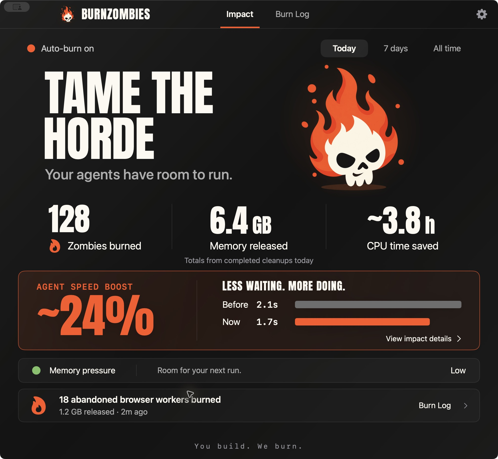
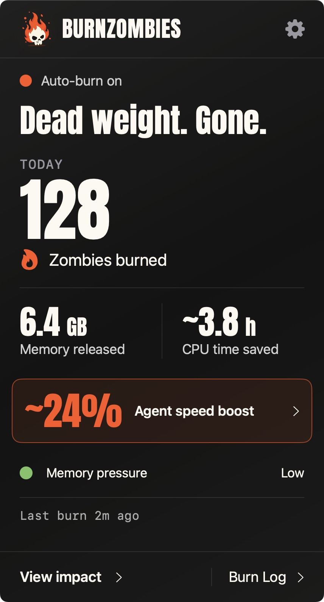
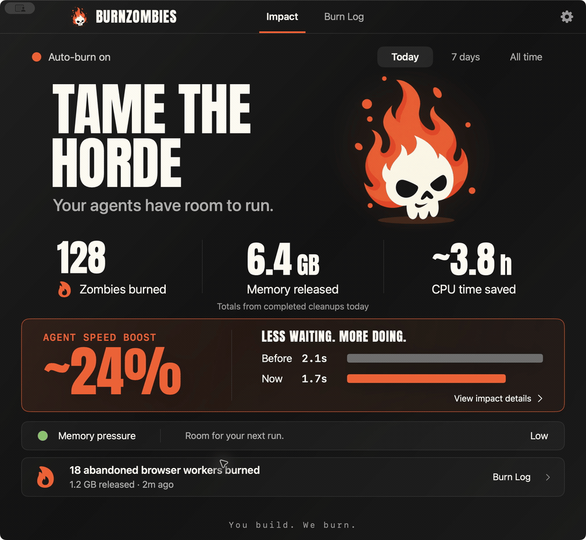
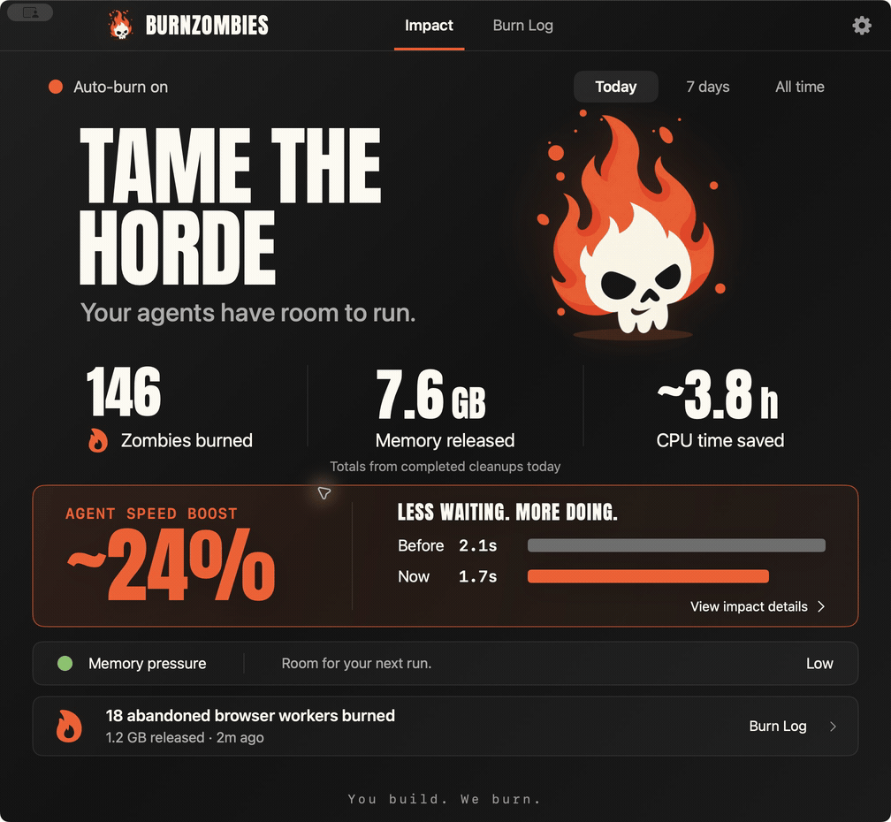

<p align="center">
  
</p>

<h1 align="center">TAME THE HORDE.</h1>
<p align="center"><strong>Your agents have room to run.</strong><br>A tiny macOS menu bar app for the helpers that outlive their welcome.</p>

<p align="center">
  <a href="https://github.com/swordfish444/BurnZombies/actions/workflows/ci.yml"></a>
  
  
  <a href="LICENSE"></a>
</p>

<p align="center"><a href="#light-the-match">Get started</a> · <a href="docs/USER_GUIDE.md">User guide</a> · <a href="docs/SAFETY.md">Safety</a> · <a href="docs/ROADMAP.md">Roadmap</a></p>



<p align="center"><em>Native app. Synthetic preview data. Zero dashboards to babysit.</em></p>

## Dead weight. Gone.

An agent finishes. Its helpers don't always get the memo. Repeat that across tools, browser automation and long-running harnesses, and yesterday's work can keep taking up room.

BurnZombies watches quietly, groups related leftovers, and stops explicitly disposable helpers after their owner is gone. Open the menu bar for the wins. Drill in when something needs your attention.

- **See the payoff.** Zombies burned, memory released, CPU time saved, and agent speed in one glance.
- **Keep your work moving.** Active sessions, user apps and ambiguous processes stay protected.
- **Burn with receipts.** Recheck identity and activity, request a graceful exit, watch for recurrence, then count it once.
- **Stay local.** SwiftUI + AppKit. No account, cloud, telemetry, LLM, privileged daemon, or package dependencies.

<table>
<tr>
<td width="35%" align="center"></td>
<td><strong>A small panel. A quick victory lap.</strong><br><br>Today’s burn count and reclaimed footprint up front. Memory pressure underneath. Impact and Burn Log are one click away.<br><br>The default view is deliberately quiet. Evidence, protection controls and cleanup previews live a level deeper.</td>
</tr>
</table>

<details>
<summary><strong>Watch the quick app tour</strong></summary>



A short sequence of actual native UI captures using demo data. The preview does not terminate any process.



A tiny celebration, then back to work. Reduce Motion is respected.

</details>

## Light the match

Requires **macOS 14+** and **Swift 6** through Xcode or Apple Command Line Tools.

```sh
git clone https://github.com/swordfish444/BurnZombies.git
cd BurnZombies
scripts/build-app.sh
open dist/BurnZombies.app
```

Look for the flaming skull in your menu bar. Monitoring starts immediately; automatic cleanup and notifications start off. This is an early source release with a local ad-hoc signature. Signed, notarized downloads are on the [roadmap](docs/ROADMAP.md).

### Give disposable helpers a known owner

The bundled CLI can register a new tool session:

```sh
cli="$PWD/dist/BurnZombies.app/Contents/MacOS/burnzombies"
"$cli" run --label "Local tool session" -- /absolute/path/to/tool
```

Add `--allow-cleanup` only for **disposable, noninteractive helpers** whose work can be discarded after the wrapper exits. Monitoring by itself never grants permission to stop arbitrary processes. [Ownership, automatic cleanup and everyday use →](docs/USER_GUIDE.md)

## A little fire. A lot of restraint.

“Zombie” is the brand; actual OS zombies are already dead and need their parent to reap them. BurnZombies distinguishes those from live abandoned helpers, growth trends and restart loops. Age, high memory, an unfamiliar name or a parent PID of 1 never grants cleanup permission. There is no force kill or general file cleaner.

Memory totals use the footprint of verified exits. The speed card compares a small local command-launch probe; its details stay in the drilldown. CPU time saved projects the observed pre-stop CPU rate over one hour, credited once after verified exit. [What we measure →](docs/VALIDATION.md) · [Detection rules →](docs/DETECTION_MATRIX.md)

## From spark to steady burn

- [x] Native menu bar panel, Impact window and Burn Log
- [x] Bounded local catalog and explicit ownership wrapper
- [x] Conservative detection, graceful cleanup and verified receipts
- [x] Real zombie bursts, detached helpers, cancellation and failure fixtures
- [x] A brief flame-and-embers celebration after verified cleanup
- [ ] Longer field validation across agent workloads
- [ ] Supported lifecycle adapters for MCP, browsers and supervisors
- [ ] Developer ID signing, notarization and broader accessibility testing
- [ ] Windows tray app with native process ownership

[Full roadmap and tradeoffs →](docs/ROADMAP.md)

## Build with us

```sh
scripts/test.sh                 # deterministic rules + native process fixtures
scripts/test.sh --integration   # full grace, exit and recurrence windows
```

Start with the [architecture](docs/ARCHITECTURE.md), [research](docs/RESEARCH.md), or [deep dive on zombie detection](docs/ZOMBIE_RESEARCH.md). The [20-repo README study](docs/README_STUDY.md) records the presentation ideas behind this page.

[Contributing](CONTRIBUTING.md) · [Security reports](SECURITY.md) · [Privacy and uninstall](docs/USER_GUIDE.md#privacy-recovery-and-uninstall) · [Brand and font credits](docs/BRAND.md)

MIT licensed. **You build. We burn.**
