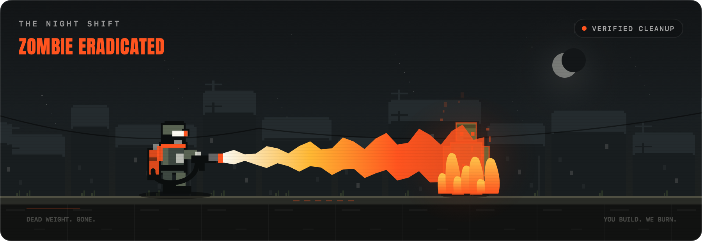

<p align="center">
  
</p>

<p align="center">
  <b>BurnZombies cleans up after your AI coding agents, on its own.</b><br>
  Every 15 minutes it burns the zombie processes, stale worktrees and rebuildable junk they leave on your Mac. You never clean your disk or hunt down a stuck process by hand again.
</p>

```sh
curl -fsSL https://raw.githubusercontent.com/swordfish444/BurnZombies/main/install.sh | bash
```

<p align="center"><sub>macOS 14+ · Apple Silicon or Intel · no account, API key or sudo · free and open source (MIT)</sub></p>

## How it works

1. **Install it.** One command. A flaming skull joins your menu bar, and within a minute it shows what it found.
2. **Run your agents.** Claude Code, Codex, Cursor: as many sessions, worktrees, dev servers and builds as you like. Nothing about how you work changes.
3. **BurnZombies burns the exhaust.** Every 15 minutes it stops zombie processes, retires worktrees you're done with and deletes rebuildable junk. Each worktree is backed up first. When it isn't sure, it asks one yes/no question and turns your answer into a rule.

<p align="center">
  
  &nbsp;
  
</p>
<p align="center"><sub><b>Minute one:</b> what BZ found &nbsp;·&nbsp; <b>When it isn't sure:</b> one tap, and it remembers &nbsp;·&nbsp; example data</sub></p>

## What it burns

| The exhaust | Your safety net |
| --- | --- |
| 🧟 **Zombie processes**: Node workers, headless browsers and build watchers whose app or chat is gone | A graceful stop. Never anything a live chat is using. |
| 📁 **Stale worktrees**: project copies you stopped using | Saved to a Git restore point first. One click restores it for 30 days. |
| 🗑️ **Rebuildable junk**: `node_modules`, build output, DerivedData | Your tools rebuild it when needed. |

It never touches macOS, your apps, your main project folders or anything a running chat is working in. [How cleanup stays safe →](docs/SAFETY.md)

## What happens next

- **Minute one.** BZ takes its first look and shows what it found. For the first half hour it looks again every minute, then every 15 minutes.
- **The obvious stuff burns on its own**, under starter rules you can switch off in **Settings → Autopilot**: programs whose app or chat is gone and that sat idle for 6+ hours with no open port, merged worktrees untouched for a month, and junk inside copies untouched for two weeks.
- **It asks about the rest**, one tap each, and only when an answer frees at least 1 GB. **Yes** burns all the matches, now and later. **No** keeps them.
- **AI sweeps are optional.** With Claude Code or Codex signed in, BZ asks it to judge what the rules don't cover, through your existing login. The first sweep starts about 10 minutes after install.

## Watch it hunt

<p align="center">
  
</p>

Click **Hunt Zombies** in the menu to start a sweep right now and watch the night shift work. Automatic sweeps stay out of sight.

## FAQ

<details>
<summary><b>Do I need Claude Code or Codex?</b></summary>

No. Without either, BZ cleans with its starter rules and your answers. With one installed and signed in, it also judges new things through your existing login. Turn AI on later with `burnzombies setup --with-ai`, or install with it off: `curl … | bash -s -- --observe-only`. [More →](docs/INSTALL.md#with-or-without-claude-code-or-codex)

</details>

<details>
<summary><b>What does it cost?</b></summary>

BurnZombies is free. AI sweeps run on your own Claude Code or Codex, only when there is something new to judge, and at most every 30 minutes. On API pricing a sweep costs roughly $0.30–$1.20; on a Claude or ChatGPT subscription it uses plan usage instead. **Settings → Usage & estimated cost** shows what sweeps cost. [Model and cost →](docs/INSTALL.md#model-and-cost)

</details>

<details>
<summary><b>Can I undo a burn?</b></summary>

Worktrees, yes: restore one from **Findings** for 30 days. Junk folders get rebuilt by your tools. Programs get a graceful stop, which can't be undone, so BZ only stops ones whose app or chat is gone.

</details>

<details>
<summary><b>Does it need Full Disk Access?</b></summary>

No. Without it, BZ skips the places macOS protects (Desktop, Documents, Downloads, iCloud Drive and other apps' data) and tells you what it skipped. To cover them too, click **Allow Full Disk Access** in the menu. [Access setup →](docs/INSTALL.md#optional-full-disk-access)

</details>

<details>
<summary><b>What does the install script do?</b></summary>

It downloads the latest release, checks it against the release's SHA-256 checksum, checks the archive's paths and the app's code signature, and puts BurnZombies.app in `~/Applications`. No sudo. Releases are signed with BurnZombies' own certificate but aren't notarized yet. [Read install.sh](install.sh) · [Installer options →](docs/INSTALL.md#installer-options)

</details>

<details>
<summary><b>Can my agent install it?</b></summary>

Yes. Give Claude Code or Codex this prompt:

> Install and set up BurnZombies using https://raw.githubusercontent.com/swordfish444/BurnZombies/main/llms.txt. Preserve my existing agent settings and verify setup without running cleanup.

</details>

<details>
<summary><b>How do I uninstall?</b></summary>

Stop BZ, then delete the app and its data folder. [Three steps →](docs/INSTALL.md#uninstall)

</details>

## Learn more

[User guide](docs/USER_GUIDE.md) · [How Autopilot decides](docs/AUTOPILOT.md) · [Safety](docs/SAFETY.md) · [Install](docs/INSTALL.md) · [MCP](docs/MCP.md) · [Roadmap](docs/ROADMAP.md) · [Contributing](CONTRIBUTING.md) · [Security](SECURITY.md)

If BurnZombies frees up room for your next run, **give it a star**. [Tell us what your agents leave behind →](https://github.com/swordfish444/BurnZombies/issues/new?template=feedback.yml)

<p align="center"><b>You build. We burn.</b></p>
