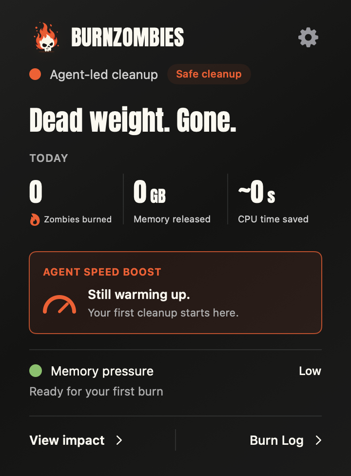
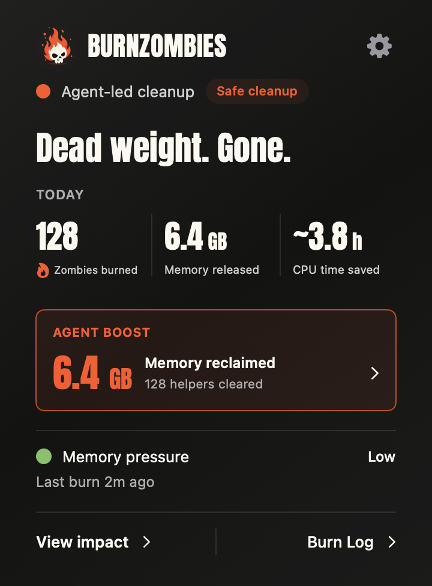
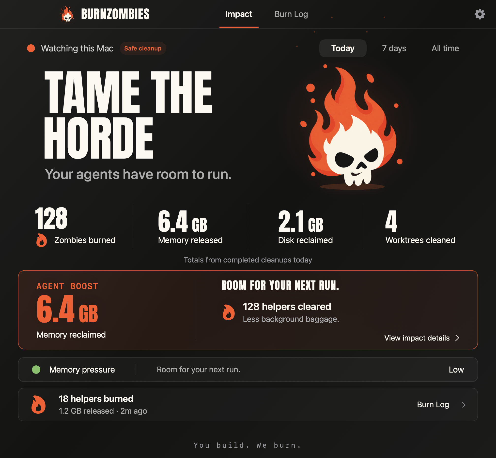

<p align="center"></p>

# BurnZombies

**Keep your agents running. Lose the leftovers.**

Long sessions leave a mess: abandoned Node workers, forgotten browser helpers, repeated build caches and worktrees full of yesterday's output. Eventually your Mac pays for work that already ended.

BurnZombies watches your whole Mac—across projects, terminals, agents and old sessions. **Your existing harness supplies the intelligence. BurnZombies runs quietly in the background, cleans up confirmed leftovers and shows what you got back.** No active chat. No reboot.

[](#install)
[](docs/MCP.md)
[](LICENSE)

## Install

```sh
curl -fsSL https://raw.githubusercontent.com/swordfish444/BurnZombies/main/install.sh | bash
```

Apple Silicon or Intel, macOS 14+. The installer selects an available **Codex, Claude Code, Cursor CLI, GitHub Copilot CLI or Gemini CLI**, starts the menu bar observer, and configures one background reviewer. The reviewer connects privately when needed; everyday chats get no hooks or always-loaded MCP connection. Use your existing harness login. No BurnZombies account, API key or package manager.

Supported tools also supply their own live ownership evidence: idle Gradle daemons can retire through Gradle, and unused Docker build cache can be reclaimed through BuildKit. Codex and Claude Code ownership and completion evidence is collected passively from local session metadata. Your working chats do no BurnZombies bookkeeping. Only a new, supported candidate can wake the reviewer; incomplete or ambiguous evidence stays protected. The observer continues across projects, even with no chat open. [Setup details →](docs/INSTALL.md)

Want to choose the brain? **Settings → Review intelligence** lets you set the model and thinking level. Expand **Usage & estimated cost** for hourly or daily charts, 1, 7 or 30 days, cached/uncached input and output, and per-model cost estimates. Idle observation uses no model tokens; new completion evidence triggers batched, limited reviews.

Installing through an agent? Tell it:

> **Install BurnZombies to watch this Mac and clean up abandoned agent helpers in the background.**

## Dead weight. Gone.

Everything that matters in one small panel: **zombies burned, memory released, disk reclaimed, worktrees cleaned and agent boost.** Every verified cleanup shows what you got back: reclaimed memory and helpers cleared, or a measured speed boost when available. **Still warming up.** only appears before your first burn.

<p align="center">
  
  
</p>

**Small by default. More when you need it.** Open Impact for Today, 7 days or All time. Burn Log keeps the cleanup receipts one click away.

<details>
<summary><strong>See the full Impact view</strong></summary>

<p align="center">
  
</p>

</details>

- **Your whole Mac.** All visible processes owned by your macOS user, across projects and sessions—not just the current agent's children.
- **Works with no chat open.** The resident observer schedules reviews. No tool-use hooks or conversation reminders.
- **Retires idle build workers safely.** Gradle reports its own state. Your AI selects an exact idle daemon; Gradle finishes any build that races the request before exiting. BZ verifies the exit before crediting memory. The first native adapter supports Gradle 8.14.6.
- **Reclaims owner-managed cache.** Local Docker build-cache records are checked individually against live references, retention and your disk policy. Containers, images, volumes and recent/shared cache stay protected. Automatic cleanup is opt-in under Disk cleanup; released Docker capacity is tracked separately from physical Mac disk space.
- **Remembers what finished.** Native ownership and bounded completion evidence feed a shared queue. A finished turn alone never authorizes a kill; active consumers keep their helpers.
- **Your harness does the thinking.** Model reasoning and live ownership evidence decide what is abandoned. No fixed “old process = zombie” rule.
- **Lose finished workspaces.** Your agent can create disposable worktrees through BurnZombies and release them after preserving the work. A second review checks completion; native guards keep active, dirty, ignored and unpushed work safe. Existing and Codex-managed checkouts remain with their owning tools. [Worktree cleanup →](docs/WORKTREE-CLEANUP.md)
- **Find the big pockets.** **Settings → Disk cleanup** follows storage across your Mac, including folders outside agent worktrees. Your AI investigates what created it, groups repeated outputs and gives you a practical next step. Cards start at 10 GB of measured unshared storage; APFS copies don't inflate the number. Scanning uses no AI tokens. Already use Mole? Its storage analysis adds context to the same bounded review. [Disk discovery & cleanup →](docs/DISK-CLEANUP.md) · [Mole integration →](docs/MOLE-INTEGRATION.md)
- **Keep the good stuff alive.** Exact identities, protected harnesses, graceful stops and verified receipts. Uncertain work stays running.
- **See the payoff.** Zombies burned, memory released, disk reclaimed, worktrees cleaned and a concrete cleanup benefit in a quiet menu bar app.
- **Spends tokens on useful work.** Reviews get a small, focused evidence batch and only the tools it needs. Completed work stays quiet, unfinished investigations stay queued, and reviews run at most hourly. No daily token cutoff strands useful work. Failures pause instead of retrying. No windows open when reviews start.

Storage inspection returns immediately with available facts while optional Mole analysis continues in the background. Slow analysis cannot monopolize the request queue.

Native code observes, schedules and verifies. Your selected harness supplies the model and uses MCP for guarded cleanup. Reviews use its existing account and usage allowance. [How it works →](docs/MCP.md) · [Lifecycle evidence →](docs/LIFECYCLE-EVIDENCE.md)

**Next:** more real-session validation, notarized Mac releases, and Windows. [Roadmap →](docs/ROADMAP.md)

[User guide](docs/USER_GUIDE.md) · [MCP](docs/MCP.md) · [How cleanup works](docs/SAFETY.md) · [Build & contribute](CONTRIBUTING.md) · [Security](SECURITY.md)

If BurnZombies clears room for your next run, **give it a star**. [Tell us what your agents leave behind](https://github.com/swordfish444/BurnZombies/issues/new?template=feedback.yml).

**You build. We burn.**
